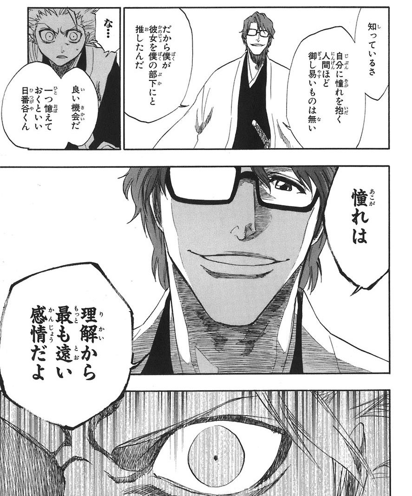

  

## CMU 15-213 Glue Lab

- [`labs/`](labs/) — Eight unofficial labs for CMU’s *Introduction to Computer Systems*.
- [`ndb/`](ndb/README.md) — A Neovim front end for GDB.
- [`literatures/`](literatures/) — Reference books and notes.
- [`skills/`](skills/README.md) — The two course skills used to gather the labs.

whisper

I feel like a treasure hunter these days and each lab is a blind box. malloclab is tasty: I overcame my fear of GDB (although there is actually nothing to be afraid of, it is just a bit like a kid afraid of the dark) and finally got my shaky code to work(preconditions and debug assertions helped). shelllab and the simulator part of cachelab are okay: the man pages became my pals. datalab, the transpose part of cachelab, and sfslab, i did not really like, felt like chewing chewed gum, so I skipped them.

For the books, I really enjoyed the parts of CSAPP about os and compiler. You don’t need to understand every page to do the labs, but i just found some topics intersting(maybe not so intersting when implementing them in an os course). The architecture book is here in case you’re curious; you don’t need it for the course. Reading it felt like a ninja trial to me and i think it is quite obscure, but I took notes on the parts I found interesting, so maybe you won’t suffer quite as much. The C book covers C23, pretty new, and its author is an expert on the C standard. I wouldn’t call it a beginner’s book, but parts of it helped me understand C and pick up good coding habits -> i decide to read it because chapter 2 of CSAPP is too wordy for me(not recommended to read), and i was just not quite confident in C at that time.

I’m a terminal person, so ndb suits me. But in case you’re a CMU student, though, keep bomblab recitation warning about GDB GUI in mind. I haven’t tested whether ndb may accidentally explodes a bomb. It just didn’t happen to me. Refining the two skills is time-costy, but what other choice did I have? 

Ah, really grateful to CMU for developing this course. It unlocks all the following system courses. But in the end of the day, it is still the first phase of the Hunter Exam in <em>Hunter × Hunter</em>. How much longer until I get my Hunter License?

