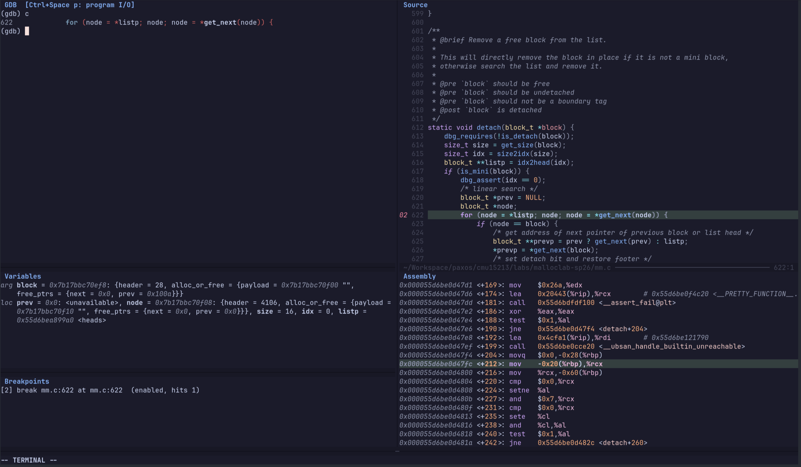
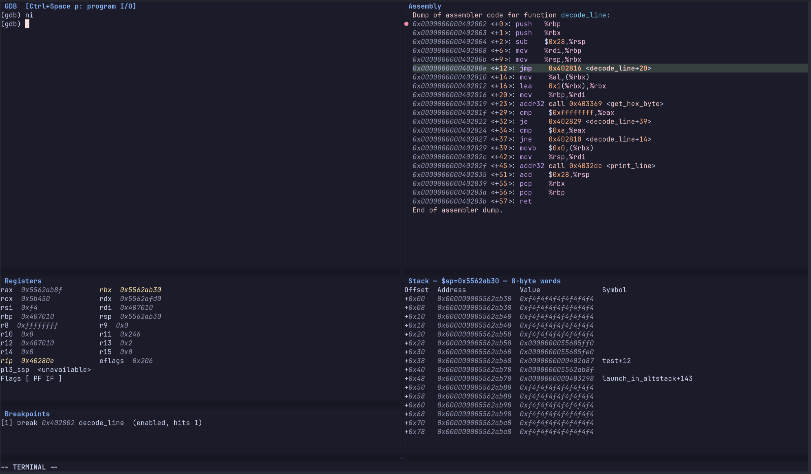

# ndb — a Neovim workspace for GDB

Debug a program in the terminal. ndb opens Neovim’s bundled Termdebug with a GDB prompt, a separate terminal for program I/O, and read-only panes that update as you step. It loads your normal Neovim configuration.

## Run it from a clone

**Supported platform: Linux x86-64.** You need Bash, Neovim **0.12+** with bundled Termdebug, GDB built with Python support, and `python3` on your `PATH`. To check GDB’s embedded Python, run `gdb -nx -q -batch -ex 'python import gdb; print(gdb.VERSION)'`: it should print a version rather than an error.

From the repository root, replace `./program` with the executable you want to debug:

```sh
./ndb/ndb ./program             # source mode; build with -g for source and variables
./ndb/ndb -a ./program          # assembly mode; also works without source
./ndb/ndb --help                # pane shortcuts and startup advice
```

Flags after the executable are passed to the program. To use `ndb` from other directories, add the tool directory to your current shell’s `PATH` from the repository root: `export PATH="$PWD/ndb:$PATH"`.

**Repeatable sessions:** Don’t put `run` or `start` in `.gdbinit`: GDB can execute them before Termdebug has finished connecting. Put startup commands in a file such as `debug.gdb` in your working directory instead:

```gdb
break main
run
```

Launch ndb, wait for the panes to appear, then type **`source debug.gdb` at the GDB prompt**. Ordinary preferences can stay in your own `.gdbinit`; ndb doesn’t change GDB’s auto-load policy.

On systems with debuginfod, ndb treats GDB’s “ask” setting as off so an invisible download prompt cannot block startup. An explicit `on` or `off` is left alone.

**Untested: GDB native reverse execution.** ndb has not been tested with GDB’s record/replay commands. In particular, pane updates after `reverse-step` or `reverse-continue` have not been verified.

## Source mode

Inspect source alongside its assembly, with function arguments, locals, and breakpoints visible at each stop.



## Assembly mode

Use `-a` or `--assembly` to put the instruction listing first. The registers pane highlights changed values. The stack pane follows the selected frame’s stack pointer and shows raw memory.



## Move between panes

Press **Ctrl+Space**, release it, then press one letter:

| Key | Source mode | Assembly mode |
| --- | --- | --- |
| `g` | GDB input | GDB input |
| `p` | Program I/O | Program I/O |
| `b` | Browse current console | Browse current console |
| `s` | Source | Stack |
| `a` | Assembly | Assembly |
| `v` | Variables | — |
| `r` | — | Registers |

The display panes use Normal mode and your usual Neovim navigation. In the two consoles, typing goes to GDB or the program. Use **Ctrl+Space**, then **b** to browse and search console output in Normal mode; use **g** or **p** after the prefix to resume input. The Neovim command `:Breakpoints` focuses the breakpoints pane in either mode.

## Optional theme: Catppuccin Mocha

The screenshots use Catppuccin Mocha with a customized background. ndb doesn’t install or force a colorscheme. If you already like your Neovim theme, there’s nothing to do.

For a similar look, install [`catppuccin/nvim`](https://github.com/catppuccin/nvim) with your Neovim plugin manager, **or** use Neovim’s native packages. For the latter, run this in your Linux shell (standard `nvim` config):

```sh
git clone --depth 1 https://github.com/catppuccin/nvim.git \
  "${XDG_DATA_HOME:-$HOME/.local/share}/nvim/site/pack/themes/start/catppuccin"
```

Try `:colorscheme catppuccin-mocha` in Neovim. To keep it for both Neovim and ndb, add `vim.cmd.colorscheme("catppuccin-mocha")` to your Neovim `init.lua` (or `colorscheme catppuccin-mocha` to `init.vim`).

## Change the tool

The files here **are** the runnable source. Edit one and relaunch; there’s nothing to rebuild.

| File | What to change |
| --- | --- |
| [`ndb`](ndb) | Launcher options, arguments, and `--help` |
| [`lib/init.lua`](lib/init.lua) | Termdebug startup and Ctrl+Space shortcuts |
| [`lib/ui.lua`](lib/ui.lua) | Pane layout, labels, and highlighting |
| [`lib/inspect.py`](lib/inspect.py) | Data GDB collects for the debugger panes |
| [`lib/pty-shell.py`](lib/pty-shell.py) | Terminal setup for program I/O |

### Test prerequisites

- **Runtime:** Linux x86-64 with Bash, Neovim 0.12+ (bundled Termdebug), GDB with Python support, and `python3`. The suite uses Python’s built-in `unittest`.
- **Test only:** `gcc` compiles the small C programs used by the tests. `tmux` gives the tests a terminal where they can send keystrokes and check the output.

From the repository root, run:

```sh
python3 -B -m unittest discover -s ndb/tests -v
```
